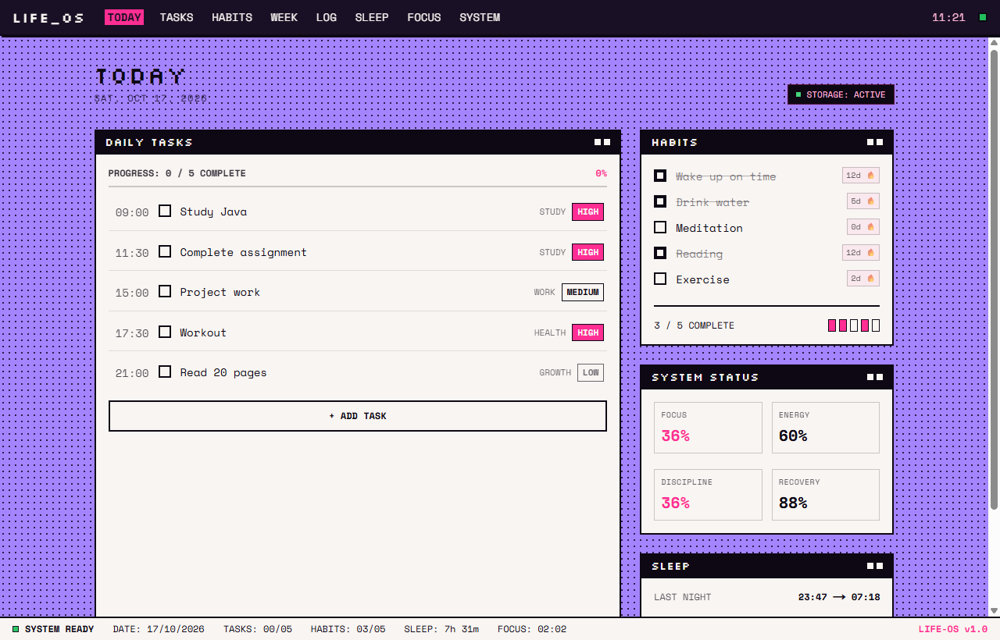
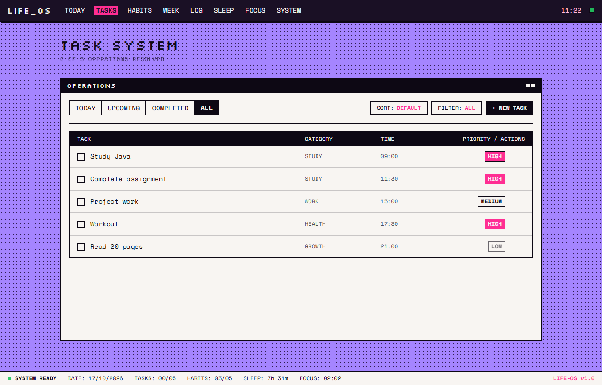
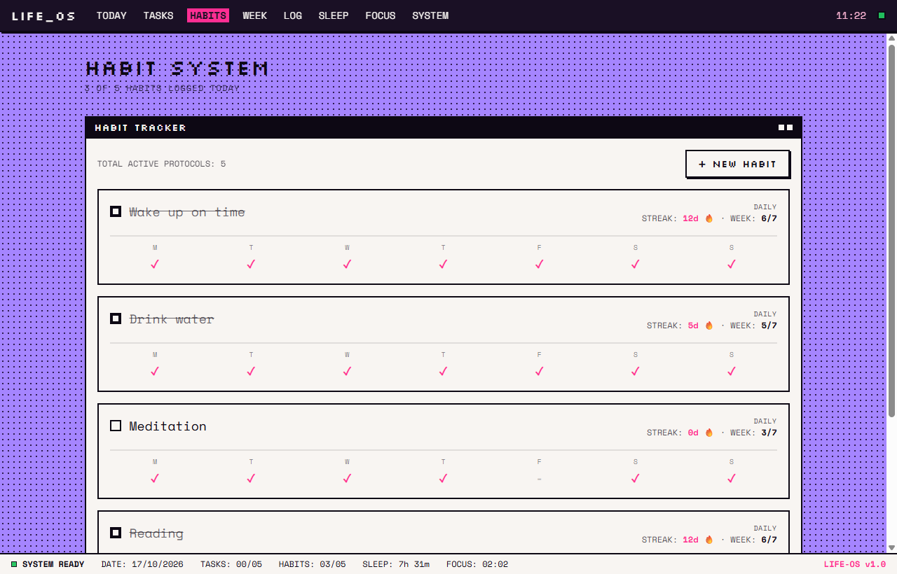
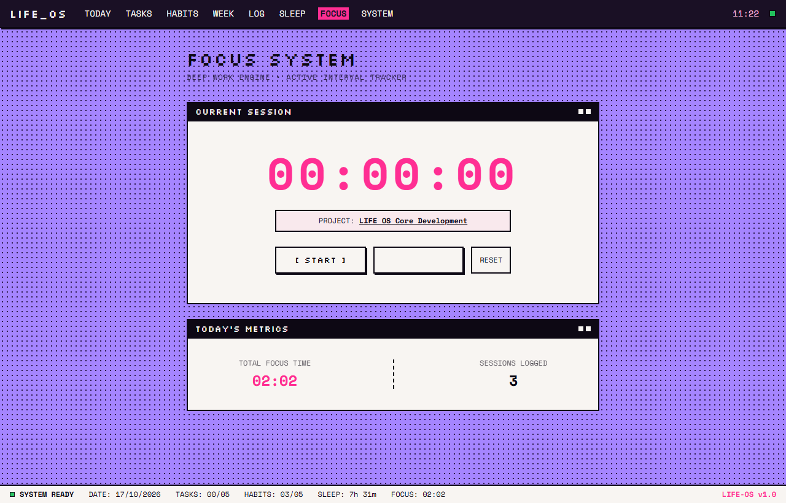
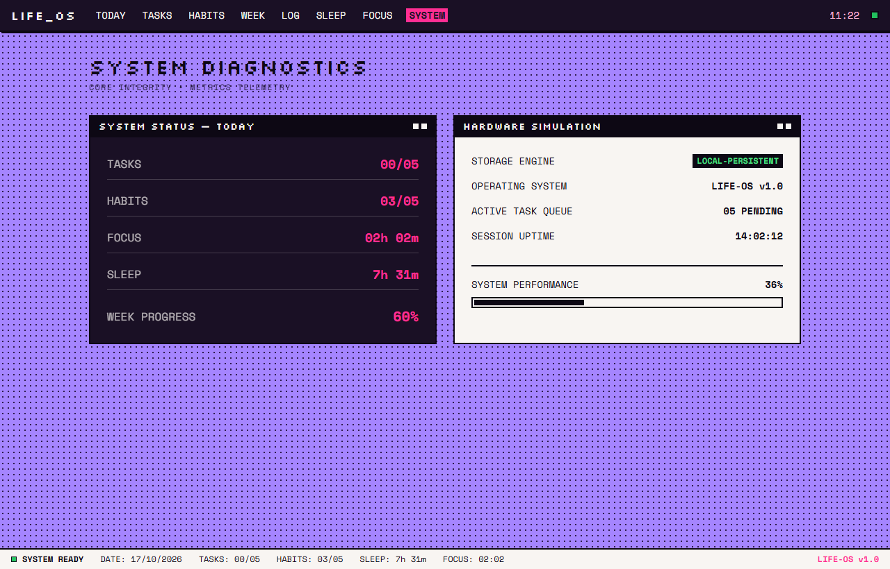
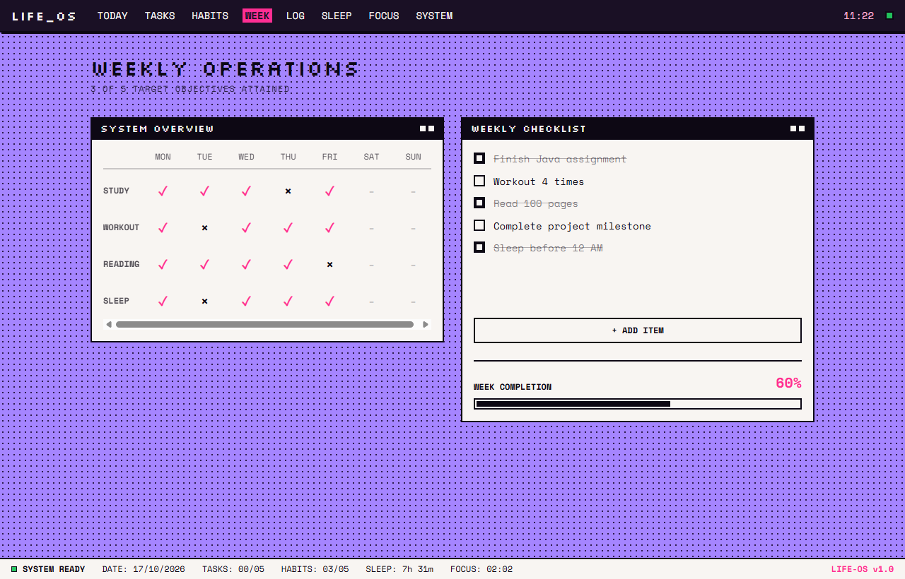
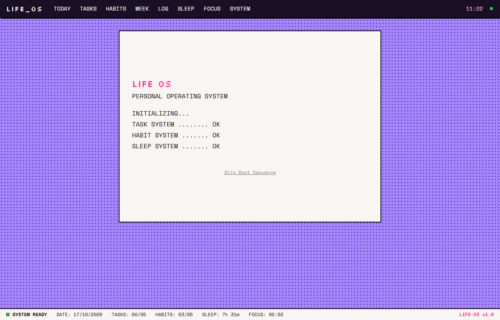

# LIFE_OS 👾
### *The Retro-Futuristic Personal Operating System for Daily Execution, Habits & Focus.*

<div align="center">

[](https://nextjs.org/)
[](https://www.typescriptlang.org/)
[](https://tailwindcss.com/)
[](https://fastify.dev/)
[](https://www.prisma.io/)
[](https://www.postgresql.org/)
[](#)

</div>

```text
    __    ________________   ____  _____
   / /   /  _/ ____/ ____/  / __ \/ ___/
  / /    / // /_  / __/    / / / /\__ \ 
 / /____/ // __/ / /___   / /_/ /___/ / 
/_____/___/_/   /_____/   \____//____/  
       PERSONAL OPERATING SYSTEM v1.0
```

---

## 🖥️ System Overview

**LIFE_OS** is an aesthetic, retro-brutalist personal productivity dashboard. Inspired by 1990s workstation UIs and cyberpunk terminal telemetry, it unifies task management, habit protocols, deep focus intervals, weekly milestones, sleep tracking, and activity audit logging into a single cohesive operating system.



---

## ⚡ Highlights & Key Modules

### 1. 🎯 Daily Operations Command Center (`/today`)
* **Real-time Task Matrix**: View today's schedule, prioritize tasks by urgency (`HIGH`, `MEDIUM`, `LOW`), and check off items with retro pixel checkboxes.
* **Habit Status & Streaks**: Quick-log daily habit completions with animated completion tallies and flame counters.
* **Telemetry Diagnostics**: Dynamically calculated **Focus**, **Energy**, **Discipline**, and **Recovery** scores derived from your daily execution.
* **Sleep Telemetry**: Instant overview of previous night's rest duration, target delta, and sleep quality status.

### 2. 📋 Task Operations Engine (`/tasks`)
* **Multi-Tab Filtering**: Toggle between `ALL`, `TODAY`, `UPCOMING`, and `COMPLETED`.
* **Dynamic Sorting & Category Filtering**: Sort tasks by `DEFAULT`, `PRIORITY`, `TIME`, or `TITLE`. Filter by categories like `STUDY`, `WORK`, `HEALTH`, `GROWTH`, and `SYSTEM`.
* **Instant Task Creation**: Retro pop-up dialog with keyboard support (`Esc` to dismiss) for instant task registration.

### 3. 🔥 Habit Protocol Matrix (`/habits`)
* **Weekly Consistency Grid**: Mon-Sun tracking visualizer with custom target thresholds (e.g. `Daily`, `4x/week`, `5x/week`).
* **Streak Counter**: Track consecutive days of adherence to reinforce positive habits.
* **Custom Protocol Creator**: Add new habits with customizable weekly targets.

### 4. ⏱️ Deep Work Focus Engine (`/focus`)
* **Active Interval Stopwatch**: Track deep work sprints in real-time.
* **Project Tagger**: Seamlessly assign focus sessions to active projects.
* **Session Logger**: Finish sessions with one click to record minutes directly into your system telemetry and activity log.

### 5. 📅 Weekly Milestone Objectives (`/week`)
* **System Overview Matrix**: High-level visual audit of your week across core disciplines (`STUDY`, `WORKOUT`, `READING`, `SLEEP`).
* **Weekly Checklist**: Add and manage key deliverables with dynamic progress bars.

### 6. 📟 Terminal Audit Log (`/log`)
* **CLI-Style Quick Input**: Type directly into the terminal prompt (`>`) to log events with automatic timestamps.
* **System Audit Trail**: Historical record of completed tasks, habit completions, and focus sprints.

### 7. 📊 System Diagnostics (`/system`)
* **Hardware Simulation**: Retro telemetry simulator with uptime counter, memory allocation, and performance gauges.

---

## 📸 Interface Gallery

| Operations (`/tasks`) | Habit Protocols (`/habits`) |
|:---:|:---:|
|  |  |

| Focus Engine (`/focus`) | System Diagnostics (`/system`) |
|:---:|:---:|
|  |  |

| Weekly Review (`/week`) | Boot Sequence (`/`) |
|:---:|:---:|
|  |  |

---

## 🏗️ Architecture & Storage Modes

LIFE_OS is built with a flexible **Dual-Mode Architecture**:

```text
┌────────────────────────────────────────────────────────────────────────┐
│                      LIFE_OS Frontend (Next.js 14)                     │
└───────────────────────────────────┬────────────────────────────────────┘
                                    │
           ┌────────────────────────┴────────────────────────┐
           ▼                                                 ▼
┌─────────────────────────────────────┐   ┌─────────────────────────────────────┐
│    MODE 1: LOCAL-FIRST (DEFAULT)    │   │      MODE 2: CLOUD API (OPTIONAL)   │
├─────────────────────────────────────┤   ├─────────────────────────────────────┤
│ • useLifeOS Reactive Hook           │   │ • Fastify Server (Port 4000)        │
│ • Persistent Browser LocalStorage   │   │ • Prisma ORM Engine                 │
│ • Instant Offline-Ready Zero Setup  │   │ • PostgreSQL Managed Database       │
│ • Real-time Cross-Module Sync       │   │ • Google OAuth2 & JWT Sessions      │
└─────────────────────────────────────┘   └─────────────────────────────────────┘
```

### 1. 🚀 Standalone Local-First Mode (Zero Setup Required)
* **100% In-Browser Execution**: All data is automatically saved to and synchronized from your browser's persistent `localStorage`.
* **Zero Configuration**: No database, Docker, or external server required.
* **Host Anywhere for Free**: Deploy straight to [Vercel](https://vercel.com), GitHub Pages, or Netlify with `npm run build`.
* **Zero Latency & Offline-Ready**: Works flawlessly without an internet connection.

### 2. ☁️ Cloud Backend Mode (Full-Stack Support)
* The repository includes a complete Fastify + Prisma backend located in [`/server`](server/).
* **Prisma ORM & PostgreSQL**: Complete relational database schema in [`schema.prisma`](server/prisma/schema.prisma) supporting multi-user persistence.
* **Google OAuth2 & JWT**: Cookie-based authentication and secure user sessions.
* **OpenAPI / Swagger**: Interactive API documentation at `http://localhost:4000/docs`.

---

## 🚀 Quickstart & Installation

### Option A: Run the Frontend (Local-First Mode)

```bash
# 1. Clone repository
git clone https://github.com/areesh-ahmed/LIFE-OS.git
cd LIFE-OS

# 2. Install dependencies
npm install

# 3. Launch development server
npm run dev
```

Open [http://localhost:3000](http://localhost:3000) in your browser. You can immediately log tasks, track habits, run focus sessions, and customize your dashboard!

---

### Option B: Run the Full-Stack Backend (Optional)

If you wish to run the Node.js/Fastify server and PostgreSQL database:

```bash
# 1. Navigate to server folder
cd server

# 2. Install dependencies
npm install

# 3. Configure environment variables
cp .env.example .env
# Edit .env and supply your DATABASE_URL, GOOGLE_CLIENT_ID, and GOOGLE_CLIENT_SECRET

# 4. Run database migrations & seed data
npx prisma migrate dev --name init
npx prisma db seed

# 5. Start Fastify backend
npm run dev
```

API documentation will be available at [http://localhost:4000/docs](http://localhost:4000/docs).

---

## 🌐 Free Cloud Deployment

Looking to deploy LIFE_OS to the web completely for free? Read the full step-by-step guide:
👉 **[Free Deployment Guide: Vercel + Render + Neon.tech](DEPLOYMENT.md)**

---

## 📁 Project Structure

```text
LIFE-OS/
├── docs/
│   └── screenshots/          # High-resolution documentation screenshots
├── public/
│   └── screenshots/          # Static web assets
├── server/                   # Fastify backend service
│   ├── prisma/
│   │   ├── schema.prisma     # PostgreSQL database schema
│   │   └── seed.ts           # Initial database seeder
│   └── src/
│       ├── modules/          # Auth, Tasks, Habits, Sleep, Focus routes
│       └── server.ts         # Fastify app initialization
├── src/
│   ├── app/                  # Next.js App Router pages
│   │   ├── today/            # Main daily dashboard
│   │   ├── tasks/            # Task management operations
│   │   ├── habits/           # Habit tracking matrix
│   │   ├── week/             # Weekly review & checklist
│   │   ├── focus/            # Deep work focus timer
│   │   ├── log/              # Command terminal & activity log
│   │   ├── sleep/            # Sleep analytics
│   │   ├── system/           # Hardware diagnostics & metrics
│   │   └── page.tsx          # System boot sequence
│   ├── components/
│   │   ├── layout/           # SystemBar header & StatusBar footer
│   │   └── ui/               # PixelCheckbox, SystemWindow, RetroModal
│   └── lib/
│       ├── storage.ts        # Unified localStorage engine & telemetry calculations
│       ├── useLifeOS.ts      # Reactive custom hook for application-wide sync
│       └── mockData.ts       # Default baseline models & fallback data
├── package.json              # Frontend scripts & dependencies
├── render.yaml               # Cloud deployment blueprint
└── tailwind.config.ts        # Custom retro color tokens & font variables
```


## 🛡️ License

Distributed under the MIT License. See `LICENSE` for more information.

<div align="center">
  <sub>Built with ❤️ for productivity, focus and daily discipline.</sub>
</div>
